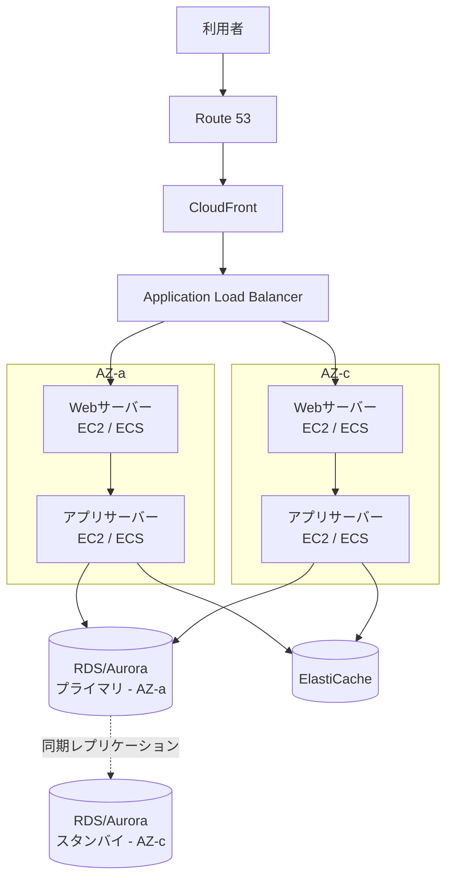
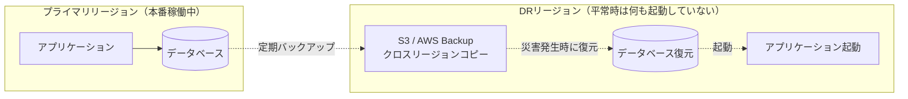
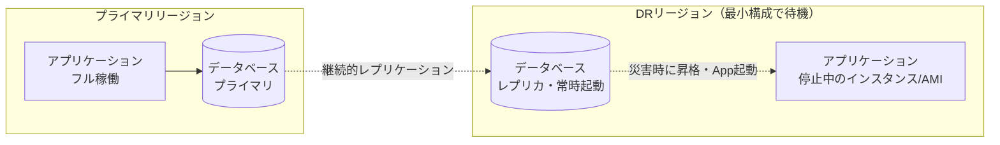
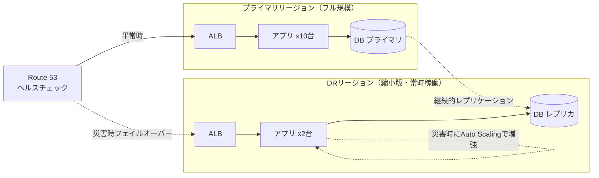
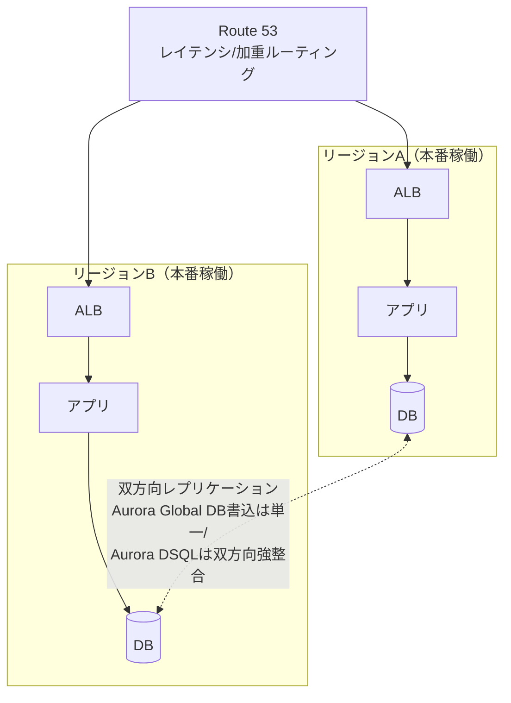
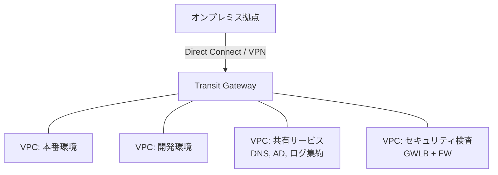
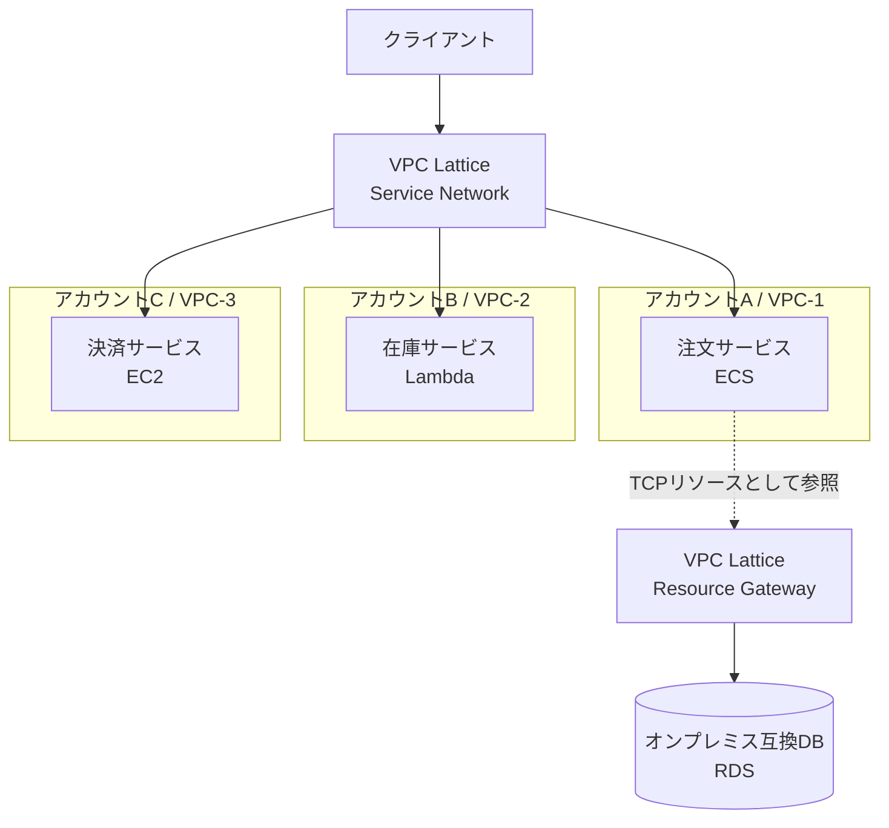
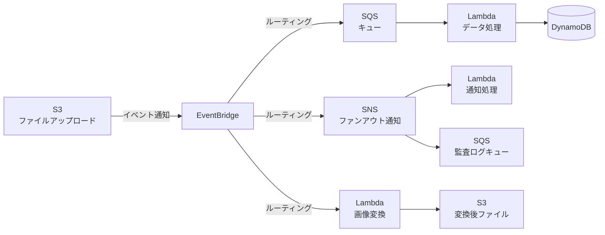
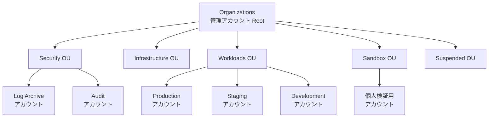
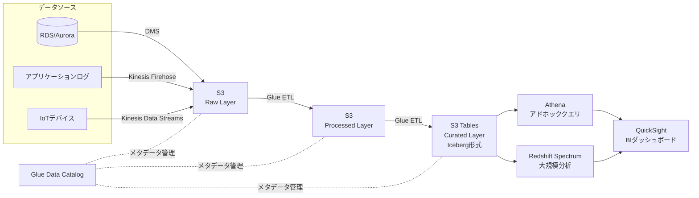

# アーキテクチャ図集

<!--
Copyright (c) 2025 AWS SAP Study Guide
Licensed under the MIT License. See LICENSE file for details.
-->

SAP-C02の設問は、文章だけでは構成イメージが掴みにくいアーキテクチャパターンを問うものが多くあります。
本ファイルは、頻出パターンを [Mermaid](https://mermaid.js.org/) 図で可視化したものです。GitHub上では自動的に図として描画されます。

## 目次

1. [3層アーキテクチャ（Multi-AZ）](#3層アーキテクチャmulti-az)
2. [災害復旧パターン: Backup and Restore](#災害復旧パターン-backup-and-restore)
3. [災害復旧パターン: Pilot Light](#災害復旧パターン-pilot-light)
4. [災害復旧パターン: Warm Standby](#災害復旧パターン-warm-standby)
5. [災害復旧パターン: Multi-Site Active/Active](#災害復旧パターン-multi-site-activeactive)
6. [Hub-and-Spoke ネットワーク（Transit Gateway）](#hub-and-spoke-ネットワークtransit-gateway)
7. [マイクロサービス間通信（VPC Lattice）](#マイクロサービス間通信vpc-lattice)
8. [サーバーレスイベント駆動アーキテクチャ](#サーバーレスイベント駆動アーキテクチャ)
9. [マルチアカウント・ランディングゾーン](#マルチアカウントランディングゾーン)
10. [データレイク／データウェアハウス統合基盤](#データレイクデータウェアハウス統合基盤)

---

## 3層アーキテクチャ（Multi-AZ）

最も基本的な高可用性パターン。各層をAZ間で冗長化する。

**試験での着眼点**: 各層が単一AZに依存していないか（SPOFの有無）を確認する。DBは同期レプリケーションのMulti-AZ配置が基本。

---

## 災害復旧パターン: Backup and Restore

最も低コスト・最も長いRTO/RPOのパターン。

**RTO/RPO目安**: 数時間〜1日 / 数時間　**コスト**: 最小

---

## 災害復旧パターン: Pilot Light

コアとなるデータベースのみ常時稼働させ、アプリ層は災害時に起動する。

**RTO/RPO目安**: 数十分 / 数分　**コスト**: 低

---

## 災害復旧パターン: Warm Standby

縮小版のフルスタックを常時稼働させ、災害時にスケールアップする。

**RTO/RPO目安**: 数分 / 秒〜分　**コスト**: 中

---

## 災害復旧パターン: Multi-Site Active/Active

複数サイトで常時本番稼働させ、災害時はトラフィック制御のみで対応する。

**RTO/RPO目安**: ほぼゼロ / ほぼゼロ　**コスト**: 最大

---

## Hub-and-Spoke ネットワーク（Transit Gateway）

多数のVPC・オンプレミス拠点を集約管理するパターン。

**試験での着眼点**: VPC Peeringのフルメッシュ（VPCが5つならペアリング10本）と比較し、Transit Gatewayなら5本の接続で済む管理性の違いを説明できるようにする。

---

## マイクロサービス間通信（VPC Lattice）

複数VPC・複数アカウントにまたがるサービスを、統一的な認証・可観測性で接続する。

**試験での着眼点**: PrivateLink/Transit Gatewayによる接続と比較し、VPC Latticeが「サービス単位」の認証・認可・可観測性を統一する点が差別化ポイント。

---

## サーバーレスイベント駆動アーキテクチャ

疎結合なコンポーネントをイベントでつなぐ設計パターン。

**試験での着眼点**: 「疎結合」「サービス間の依存を減らしたい」というキーワードが出たら、直接呼び出しではなくEventBridge/SQS/SNSを挟む設計を検討する（[12. 頻出キーワード対応表](./12-keyword-cheatsheet.md)参照）。

---

## マルチアカウント・ランディングゾーン

Control Towerで構築する標準的なOU構成。

**試験での着眼点**: `Log Archive`（CloudTrail/Configログの集約）と`Audit`（セキュリティ監査用の読み取り専用アクセス）はControl Tower導入時に自動生成される専用アカウントである点を押さえる。

---

## データレイク／データウェアハウス統合基盤

データレイクハウスパターン（構造化・非構造化データの統合分析基盤）。

**試験での着眼点**: データレイク（スキーマオンリード、柔軟）とデータウェアハウス（スキーマオンライト、高速集計）の使い分け、および両者を統合するレイクハウスパターンの理解（[07. アーキテクチャパターン](./07-architecture.md)参照）。

---

## ライセンス

このコンテンツは MIT License の下で公開されています。詳細は [LICENSE](./LICENSE) ファイルをご確認ください。
